# Petunjuk Penggunaan

## Sistem Manajemen MTs Al-Ittihad

Versi 1.0 · 19 Oktober 2026

---

## Daftar Isi

- [Bab 1 — Pendahuluan](#m9facynzpdk.96)
  - Tentang Sistem · Peran Pengguna · Login · Navigasi · Konvensi
- [Bab 2 — Setup Awal](#m9facynzpdk.3331) `[Admin]`
  - Identitas Madrasah · Tahun Ajaran · Operasional · Akun Kas & Bank
- [Bab 3 — Manajemen Guru](#m9facynzpdk.6611) `[Admin]` `[TU]`
  - Daftar Guru · Tambah/Edit · Wali Kelas
- [Bab 4 — Manajemen Siswa](#m9facynzpdk.9673) `[Admin]` `[TU]`
  - Daftar · Tambah Siswa (PPDB) · Detail Siswa · Alumni
- [Bab 5 — Kelas & Jadwal](#m9facynzpdk.13353) `[Admin]` `[TU]`
  - Data Kelas · Susun Jadwal · Deteksi Bentrok · Salin Jadwal
- [Bab 6 — Template & Penetapan Tagihan](#m9facynzpdk.16390) `[Admin]` `[Bendahara]`
  - Template · Penetapan ke Siswa · Override Jatuh Tempo
- [Bab 7 — Pembayaran](#m9facynzpdk.20117) `[Bendahara]`
  - Alur Kasir · Alokasi Waterfall · Cicilan · Kuitansi & WA · Reversal
- [Bab 8 — Tunggakan](#m9facynzpdk.24809) `[Bendahara]` `[Admin]`
  - Daftar · Aging · Filter · Notifikasi WhatsApp
- [Bab 9 — Absensi](#m9facynzpdk.27605) `[TU]`
  - Absensi Hari Ini · Terlambat Otomatis · Rekapitulasi · Absensi Guru
- [Bab 10 — Kas & Bank](#m9facynzpdk.30807) `[Bendahara]` `[Admin]`
  - Daftar Transaksi · Input Manual · Akun · Mutasi
- [Bab 11 — Anggaran](#m9facynzpdk.33618) `[Bendahara]` `[Admin]`
  - RAB · Realisasi
- [Bab 12 — Laporan Keuangan](#m9facynzpdk.35803) `[Bendahara]` `[Admin]`
  - BKU · Dana BOS · Neraca · Penerimaan Siswa · Export & Cetak
- [Bab 13 — Kalender](#m9facynzpdk.38776)
  - Tampilan · Tambah Event · Edit & Hapus
- [Bab 14 — Sistem](#m9facynzpdk.40875) `[Admin]`
  - Manajemen Pengguna · Log Aktivitas · Pengaturan

---

- [Lampiran A — Glosarium](#m9facynzpdk.44332)
- [Lampiran B — FAQ & Troubleshooting](#m9facynzpdk.46996)

## Bab 1 — Pendahuluan

### 1.1 Tentang Sistem

Sistem Manajemen MTs Al-Ittihad adalah aplikasi berbasis web untuk pengelolaan administrasi madrasah yang mencakup tiga bidang utama:

- **Akademik**: data siswa, guru, kelas, jadwal pelajaran, dan absensi
- **Keuangan**: tagihan, pembayaran, tunggakan, kas & bank, anggaran, dan laporan
- **Sistem**: manajemen pengguna, log aktivitas, dan pengaturan global

Aplikasi diakses melalui browser di perangkat desktop maupun mobile. Tidak diperlukan instalasi tambahan.

### 1.2 Peran Pengguna

Terdapat tiga peran yang dapat ditetapkan Admin kepada setiap pengguna:

| Peran | Deskripsi | Akses |
| --- | --- | --- |
| **Admin** | Pengelola penuh sistem | Semua menu dan fitur |
| **Bendahara** | Staf keuangan | Keuangan (penuh) + Siswa (hanya baca) |
| **TU** | Tata Usaha | Akademik (penuh) + Absensi |

Menu yang tidak termasuk hak akses peran Anda tidak akan ditampilkan di sidebar.

### 1.3 Cara Login

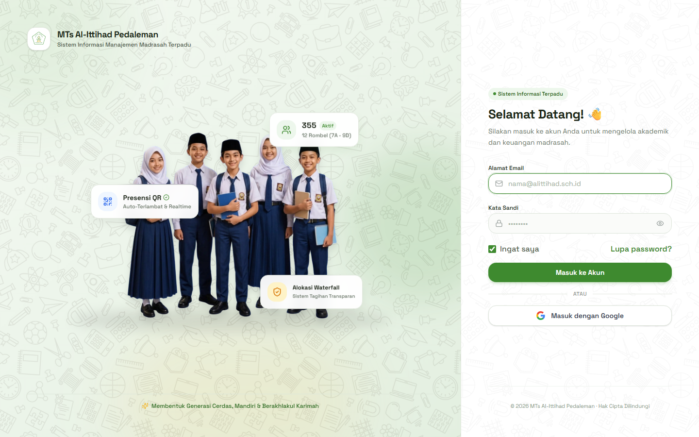
*Gambar 1.1: Halaman Login Sistem Manajemen MTs Al-Ittihad*

1. Buka aplikasi di browser melalui URL yang disediakan
2. Anda dapat masuk menggunakan dua metode:
   - **Metode Email & Password**:
     - Masukkan alamat **Email** terdaftar (contoh: `admin@gmail.com`).
     - Masukkan **Password** (klik ikon mata untuk menampilkan/menyembunyikan karakter).
     - Klik tombol **Masuk**.
   - **Metode Akun Google**:
     - Klik tombol **Masuk dengan Google** untuk autentikasi cepat menggunakan akun Google resmi madrasah.

Jika lupa kata sandi, klik tautan **Lupa password?** di bawah tombol Masuk untuk menerima instruksi pemulihan ke email Anda.

#### Ganti Password

1. Klik nama pengguna di pojok kanan atas
2. Pilih **Ganti Password**
3. Isi tiga field berikut:
   - **Password Lama** \* — password yang sedang digunakan
   - **Password Baru** \* — minimal 8 karakter
   - **Konfirmasi Password Baru** \* — ketik ulang password baru, harus identik
4. Klik **Simpan**

Jika lupa password, minta Admin melakukan reset melalui menu Sistem → Pengguna.

### 1.4 Navigasi Aplikasi

#### Desktop — Sidebar Kiri

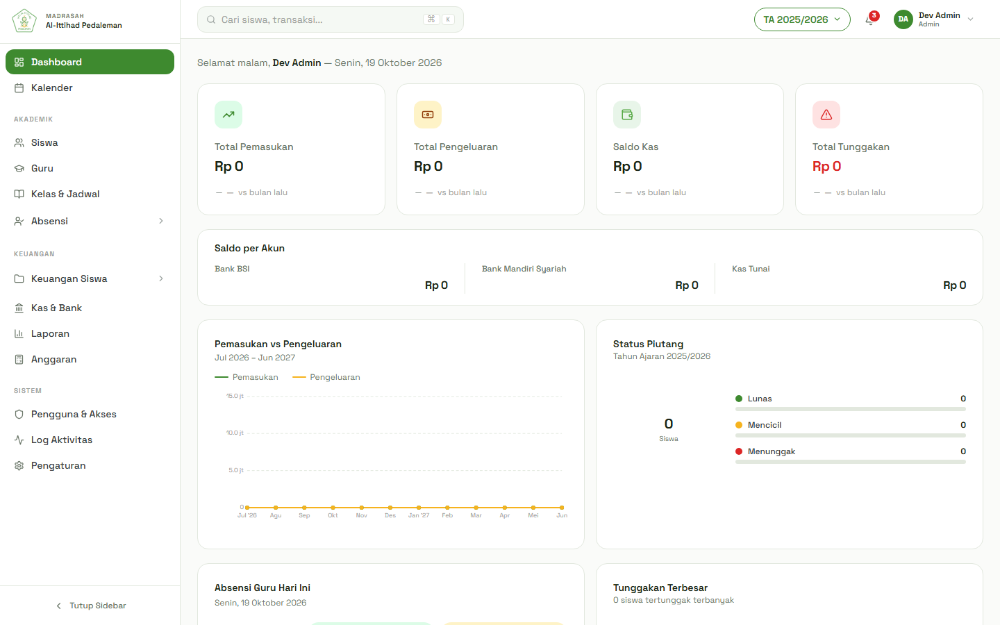
*Gambar 1.2: Navigasi Sidebar Desktop dengan pengelompokan Akademik, Keuangan, dan Sistem*

Sidebar dibagi dalam tiga grup yang dapat dibuka-tutup. Hanya satu grup terbuka pada satu waktu.

**Grup AKADEMIK**

- Dashboard — ringkasan data keseluruhan
- Kalender — agenda dan hari libur madrasah
- Siswa — data dan profil siswa aktif
- Guru — data dan profil guru
- Kelas & Jadwal — pengaturan kelas dan penjadwalan
- Absensi — input dan rekap absensi siswa

**Grup KEUANGAN**

- Pembayaran — kasir penerimaan pembayaran
- Tunggakan — daftar siswa belum lunas *(badge angka jumlah siswa)*
- Tagihan — template dan penetapan tagihan
- Kas & Bank — buku kas dan rekening bank
- Laporan — BKU, Dana BOS, Neraca, dan laporan lain
- Anggaran — RAB dan realisasi anggaran

**Grup SISTEM** `[Admin]`

- Pengguna — kelola akun dan peran
- Log Aktivitas — riwayat semua tindakan di sistem
- Pengaturan — konfigurasi global madrasah

#### Mobile — Bottom Navigation

<div style="text-align: center;">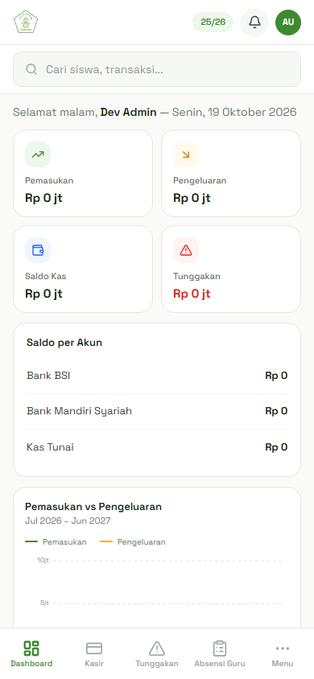
*Gambar 1.3: Tampilan Aplikasi pada Layar Mobile dengan Bottom Navigation Bar*</div>

Pada tampilan mobile, navigasi utama tersedia di bagian bawah layar:

| Tombol | Tujuan |
| --- | --- |
| Dashboard | Halaman utama |
| Pembayaran | Kasir langsung |
| Tunggakan | Daftar tunggakan |
| Absensi | Input absensi hari ini |
| Menu | Buka seluruh navigasi |

### 1.5 Konvensi dalam Buku Ini

| Simbol / Penanda | Arti |
| --- | --- |
| Tidak ada label peran | Berlaku untuk semua peran |
| `[Admin]` | Hanya untuk peran Admin |
| `[Bendahara]` | Hanya untuk peran Bendahara |
| `[TU]` | Hanya untuk peran Tata Usaha |
| \* (tanda bintang) | Field wajib diisi |
| *Gambar X.X* | Ilustrasi tangkapan layar antarmuka sistem |

**Format data standar yang berlaku di seluruh sistem:**

| Jenis Data | Format | Contoh |
| --- | --- | --- |
| Tanggal | dd/mm/yyyy | 19/10/2026 |
| Uang | Rp (spasi) angka titik-ribuan | Rp 1.500.000 |
| Jam | HH.MM | 07.00 |
| Nomor Kuitansi | KW/{TAHUN}/{BULAN}/{URUT} | KW/2026/10/001 |

## Bab 2 — Setup Awal `[Admin]`

Setup awal dikerjakan sekali oleh Admin sebelum sistem mulai digunakan. Semua pengaturan ini menjadi **sumber kebenaran global** yang memengaruhi seluruh fitur aplikasi.

Buka melalui sidebar: **Sistem → Pengaturan**.

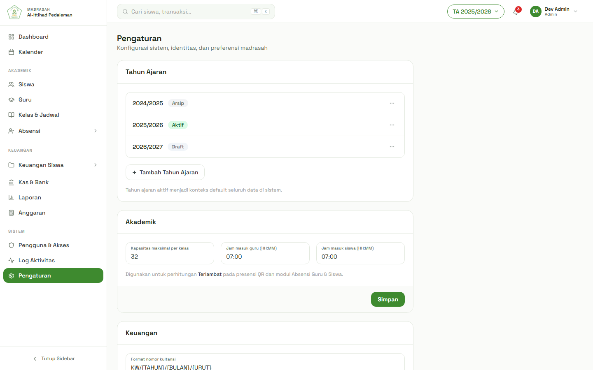
*Gambar 2.1: Halaman Pengaturan Sistem (Identitas Madrasah, Tahun Ajaran, dan Jam Masuk)*

### 2.1 Identitas Madrasah

Data identitas digunakan pada kop kuitansi dan dokumen PDF yang dicetak sistem.

| Field | Keterangan | Wajib |
| --- | --- | --- |
| **Nama Madrasah** | Nama lengkap madrasah | \* |
| **Alamat** | Alamat lengkap termasuk desa/kelurahan dan kecamatan | \* |
| **NPSN** | Nomor Pokok Sekolah Nasional, 8 digit angka | \* |
| **Nama Kepala Madrasah** | Nama lengkap beserta gelar, muncul di kop dokumen | \* |
| **NIP Kepala** | NIP kepala madrasah (bisa dikosongkan jika non-PNS) |  |
| **Nomor Telepon** | Nomor telepon madrasah yang dapat dihubungi |  |
| **Email** | Alamat email madrasah |  |
| **Logo** | File gambar logo madrasah (PNG/JPG, maks. 1 MB) |  |

Setelah mengisi semua field, klik **Simpan Identitas**.

### 2.2 Tahun Ajaran Aktif

Tahun ajaran aktif menjadi konteks global untuk seluruh data: siswa, tagihan, absensi, dan laporan keuangan semua mengacu pada tahun ajaran yang aktif.

| Field | Keterangan | Wajib |
| --- | --- | --- |
| **Tahun Ajaran** | Format: YYYY/YYYY (contoh: 2026/2027) | \* |
| **Tanggal Mulai** | Tanggal awal efektif tahun ajaran (dd/mm/yyyy) | \* |
| **Tanggal Selesai** | Tanggal akhir tahun ajaran (dd/mm/yyyy) | \* |
| **Semester Aktif** | Pilih: Ganjil atau Genap | \* |

> **Perhatian**: Mengubah tahun ajaran aktif di tengah tahun berjalan akan memengaruhi filter data di semua halaman. Konsultasikan dengan seluruh operator sebelum melakukan perubahan.

Klik **Simpan Tahun Ajaran** setelah selesai.

### 2.3 Pengaturan Operasional

Pengaturan ini mengontrol perilaku perhitungan otomatis di sistem.

| Field | Keterangan | Default | Wajib |
| --- | --- | --- | --- |
| **Jam Masuk Standar** | Batas waktu Hadir vs. Terlambat untuk absensi siswa, format HH.MM | 07.00 | \* |
| **Kapasitas Kelas** | Jumlah maksimum siswa per kelas | 32 | \* |
| **Format Nomor Kuitansi** | Template penomoran otomatis. Variabel yang tersedia: `{TAHUN}`, `{BULAN}`, `{URUT}` | KW/{TAHUN}/{BULAN}/{URUT} | \* |

**Penjelasan Format Nomor Kuitansi:**

- `{TAHUN}` — diganti dengan tahun 4 digit (contoh: 2026)
- `{BULAN}` — diganti dengan bulan 2 digit (contoh: 10 untuk Oktober)
- `{URUT}` — nomor urut transaksi dalam bulan tersebut, dimulai dari 001
- Hasil contoh: `KW/2026/10/001`, `KW/2026/10/002`, dst.

Klik **Simpan Operasional** setelah selesai.

### 2.4 Akun Kas & Bank

Daftarkan semua akun keuangan madrasah di sini. Akun-akun ini akan muncul sebagai pilihan saat memasukkan transaksi di menu Kas & Bank.

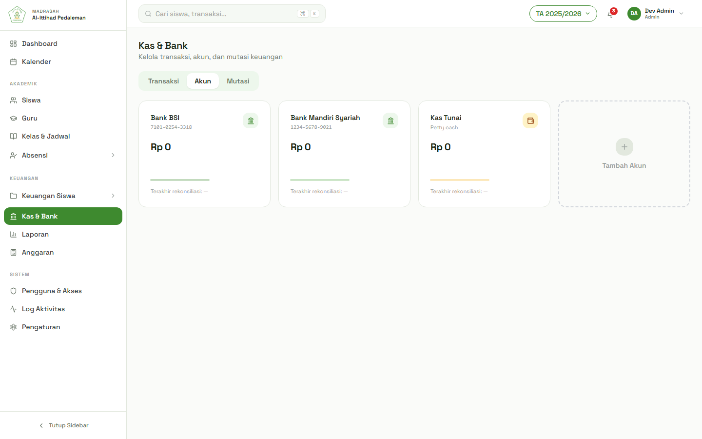
*Gambar 2.2: Pengelolaan Akun Kas & Bank dan Form Penambahan Rekening*

Untuk menambah akun baru, klik tombol **+ Tambah Akun**, lalu isi:

| Field | Keterangan | Wajib |
| --- | --- | --- |
| **Nama Akun** | Nama deskriptif akun (contoh: BSI, Mandiri Syariah, Kas Tunai) | \* |
| **Jenis Akun** | Pilih: Bank atau Tunai | \* |
| **Nama Bank** | Nama lembaga keuangan (muncul hanya jika Jenis = Bank) | \* |
| **Nomor Rekening** | Nomor rekening bank (muncul hanya jika Jenis = Bank) | \* |
| **Saldo Awal** | Saldo akun pada saat sistem pertama kali digunakan (Rp) | \* |
| **Keterangan** | Catatan tambahan opsional |  |

Klik **Simpan** untuk menyimpan akun. Akun yang sudah memiliki transaksi tidak dapat dihapus, hanya dapat dinonaktifkan.

**Akun default yang direkomendasikan:**

| Nama | Jenis | Keterangan |
| --- | --- | --- |
| BSI | Bank | Rekening Bank Syariah Indonesia |
| Mandiri Syariah | Bank | Rekening Bank Syariah Mandiri |
| Kas Tunai | Tunai | Kas fisik di madrasah |

## Bab 3 — Manajemen Guru `[Admin]` `[TU]`

Buka melalui sidebar: **Akademik → Guru**.

### 3.1 Daftar Guru

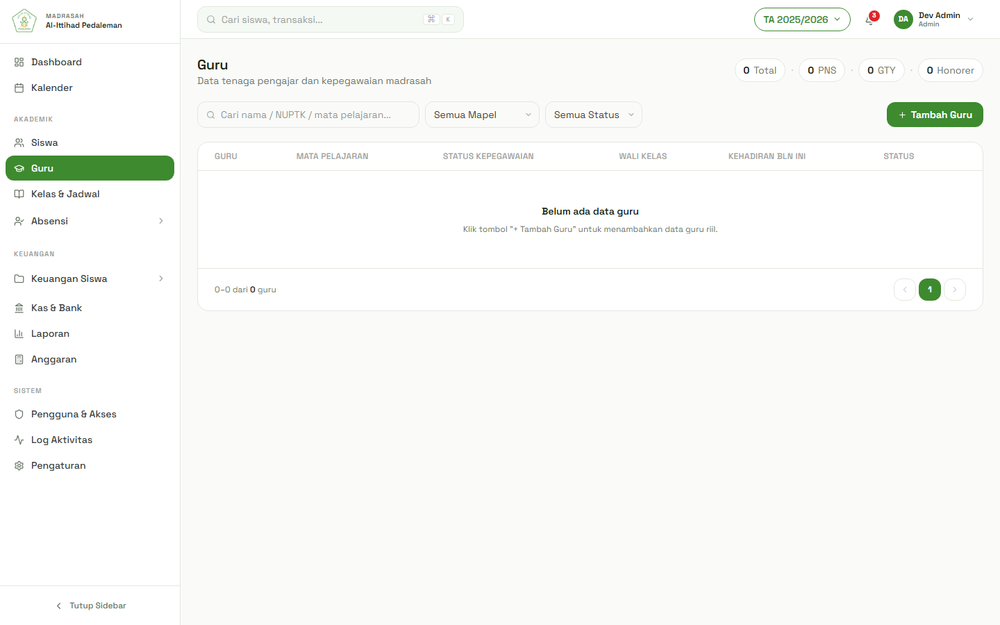
*Gambar 3.1: Halaman Data Guru dan Tenaga Kependidikan*

Halaman ini menampilkan seluruh guru yang terdaftar dalam sistem. Kolom-kolom yang tersedia:

| Kolom | Isi |
| --- | --- |
| **Nama** | Nama lengkap guru beserta gelar |
| **NIP / NIK** | Nomor Induk Pegawai (PNS) atau NIK KTP (Non-PNS) |
| **Status** | PNS / GTY (Guru Tetap Yayasan) / Honorer |
| **Mapel** | Mata pelajaran yang diampu (bisa lebih dari satu) |
| **NUPTK** | Nomor Unik Pendidik dan Tenaga Kependidikan |
| **Wali Kelas** | Kelas yang diwalii (kosong jika bukan wali kelas) |
| **Aksi** | Tombol Edit dan Detail |

**Pencarian dan filter yang tersedia:**

- **Search**: ketik nama, NIP, atau NUPTK di kotak pencarian
- **Filter Status**: semua / PNS / GTY / Honorer
- **Filter Mapel**: pilih satu mata pelajaran

Jumlah hasil pencarian ditampilkan di bawah filter ("1–10 dari 38 guru").

### 3.2 Tambah Guru Baru

Klik tombol **+ Tambah Guru** untuk membuka form di panel samping (Sheet).


*Gambar 3.2: Panel Penambahan dan Pengeditan Data Guru*

#### Tab Identitas

| Field | Keterangan | Wajib |
| --- | --- | --- |
| **Nama Lengkap** | Nama lengkap guru beserta gelar akademik | \* |
| **Jenis Kelamin** | Pilih: Laki-laki atau Perempuan | \* |
| **Tempat Lahir** | Nama kota/kabupaten tempat lahir |  |
| **Tanggal Lahir** | Format dd/mm/yyyy |  |
| **Alamat** | Alamat tempat tinggal guru |  |
| **Nomor HP** | Nomor WhatsApp aktif (diawali 08 atau +62) |  |
| **Email** | Alamat email aktif |  |

#### Tab Kepegawaian

| Field | Keterangan | Wajib |
| --- | --- | --- |
| **Status Kepegawaian** | Pilih: PNS / GTY / Honorer | \* |
| **NIP** | Nomor Induk Pegawai — muncul hanya jika Status = PNS | \* (jika PNS) |
| **NIK** | Nomor KTP 16 digit | \* |
| **NUPTK** | 16 digit angka, boleh kosong jika belum memiliki |  |
| **Tanggal Mulai Tugas** | Tanggal pertama bertugas di madrasah ini (dd/mm/yyyy) |  |
| **Mata Pelajaran** | Pilih satu atau lebih mapel yang diampu (multi-select) | \* |

**Daftar mata pelajaran yang tersedia:** Matematika, IPA, IPS, Bahasa Indonesia, Bahasa Arab, Bahasa Inggris, Fiqih, PAI, Tahfidz, PKn, Prakarya, SBK, Penjaskes.

Setelah semua field terisi, klik **Simpan** di bagian bawah panel. Sistem akan menampilkan notifikasi konfirmasi.

### 3.3 Edit Data Guru

1. Pada daftar guru, klik ikon **Edit** (ikon pensil) di baris guru yang ingin diubah
2. Panel Sheet terbuka menampilkan data guru saat ini
3. Ubah field yang diperlukan
4. Klik **Simpan**

Semua perubahan tercatat otomatis di Log Aktivitas.

### 3.4 Menetapkan Wali Kelas

Wali kelas dapat ditetapkan melalui dua cara:

**Cara 1 — dari halaman Guru:**

1. Buka form Edit guru yang bersangkutan
2. Pada tab Kepegawaian, cari field **Wali Kelas**
3. Pilih kelas dari dropdown (7A – 9D, atau kosong jika bukan wali kelas)
4. Klik **Simpan**

**Cara 2 — dari halaman Kelas & Jadwal:** Lihat Bab 5.1 untuk instruksi lengkap.

> **Catatan**: Setiap kelas hanya boleh memiliki satu wali kelas. Jika Anda menetapkan wali kelas baru untuk kelas yang sudah ada walinya, penugasan lama akan otomatis digantikan.

### 3.5 Lihat Detail Guru

Klik nama guru pada daftar untuk membuka Sheet detail, yang menampilkan:

- **Tab Profil**: semua data identitas dan kepegawaian
- **Tab Jadwal**: jadwal mengajar guru di semua kelas dan hari
- **Tab Absensi**: rekap kehadiran mengajar (jika fitur absensi guru diaktifkan)

## Bab 4 — Manajemen Siswa `[Admin]` `[TU]`

Buka melalui sidebar: **Akademik → Siswa**.

### 4.1 Daftar Siswa

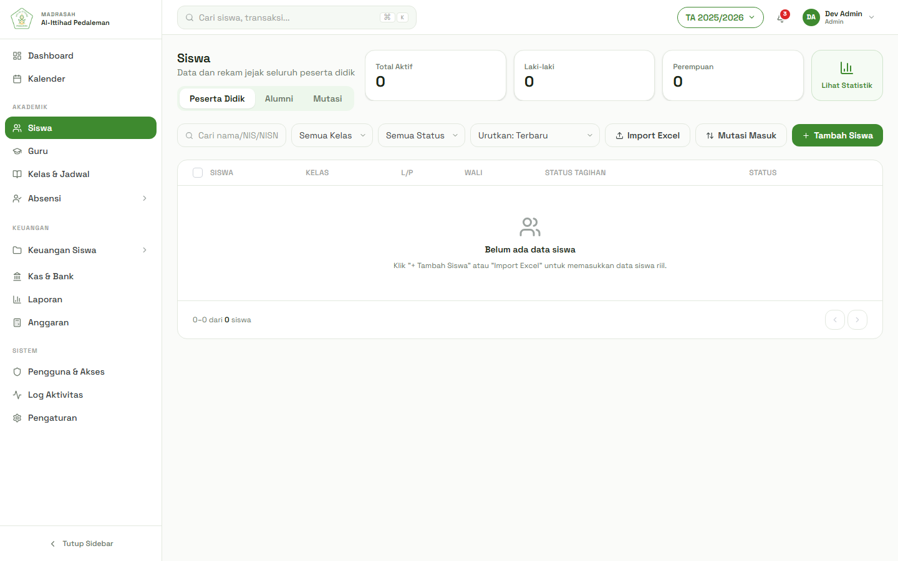
*Gambar 4.1: Halaman Data Siswa Aktif dengan Filter Kelas dan Status*

Halaman ini menampilkan seluruh siswa aktif. Kolom-kolom tabel:

| Kolom | Isi |
| --- | --- |
| **NIS** | Nomor Induk Siswa (unik per siswa) |
| **Nama** | Nama lengkap siswa |
| **Kelas** | Kelas saat ini (7A – 9D) |
| **L/P** | Jenis kelamin |
| **Nama Wali** | Nama orang tua/wali siswa |
| **Status Tagihan** | Lunas / Mencicil / Menunggak |
| **Aksi** | Tombol Detail |

**Pencarian dan filter yang tersedia:**

- **Search**: ketik nama, NIS, atau NISN di kotak pencarian (minimal 2 karakter)
- **Filter Kelas**: semua kelas / 7A / 7B / ... / 9D
- **Filter Jenis Kelamin**: semua / Laki-laki / Perempuan
- **Filter Status**: Aktif / Alumni

Jumlah hasil mengikuti filter aktif ("1–10 dari 42 siswa kelas 7A").

### 4.2 Tambah Siswa Baru (PPDB)

Digunakan untuk mendaftarkan siswa baru pada saat Penerimaan Peserta Didik Baru (PPDB).

Klik tombol **+ Tambah Siswa** untuk membuka form di panel Sheet.


*Gambar 4.2: Formulir Pendaftaran Siswa Baru (PPDB)*

#### Tab Identitas Siswa

| Field | Keterangan | Wajib |
| --- | --- | --- |
| **NIS** | Nomor Induk Siswa, diisi manual atau dibuat otomatis oleh sistem | \* |
| **NISN** | Nomor Induk Siswa Nasional, 10 digit |  |
| **Nama Lengkap** | Nama lengkap sesuai akta lahir | \* |
| **Jenis Kelamin** | Pilih: Laki-laki atau Perempuan | \* |
| **Tempat Lahir** | Kota/kabupaten tempat lahir |  |
| **Tanggal Lahir** | Format dd/mm/yyyy | \* |
| **Alamat** | Alamat tempat tinggal siswa |  |
| **Kelas** | Kelas yang dituju (7A – 9D) | \* |
| **Tahun Masuk** | Tahun ajaran pertama masuk madrasah | \* |

#### Tab Orang Tua / Wali

| Field | Keterangan | Wajib |
| --- | --- | --- |
| **Nama Wali** | Nama lengkap orang tua atau wali yang dapat dihubungi | \* |
| **Hubungan** | Pilih: Ayah / Ibu / Wali | \* |
| **Nomor WhatsApp** | Nomor WA aktif wali (diawali 08 atau +62) — digunakan untuk pengiriman kuitansi | \* |
| **Pekerjaan Wali** | Pekerjaan orang tua/wali |  |
| **Alamat Wali** | Jika berbeda dengan alamat siswa |  |

Setelah semua field wajib terisi, klik **Simpan**. Siswa baru langsung muncul di daftar. Tagihan PPDB belum otomatis ditambahkan — lihat Bab 6.2 untuk menetapkan tagihan.

### 4.3 Sheet Detail Siswa

Klik nama siswa untuk membuka Sheet detail dari sisi kanan layar.


*Gambar 4.3: Tampilan Profil Detail Siswa dan Rekapitulasi Tagihan*

Sheet detail terdiri dari tiga tab:

#### Tab Profil

Menunjukkan semua data identitas dan data orang tua/wali. Klik **Edit** untuk mengubah data.

Field yang dapat diubah sama dengan field saat pendaftaran (lihat 4.2).

#### Tab Keuangan `[Bendahara]`

Menunjukkan ringkasan keuangan siswa:

| Informasi | Keterangan |
| --- | --- |
| **Tagihan Aktif** | Daftar paket tagihan yang berlaku untuk siswa ini |
| **Total Tagihan** | Jumlah total semua komponen tagihan |
| **Total Dibayar** | Jumlah yang sudah diterima dari siswa |
| **Sisa** | Total tagihan dikurangi total dibayar |
| **Status** | Lunas / Mencicil / Menunggak |
| **Riwayat Pembayaran** | Daftar semua transaksi pembayaran dengan tanggal dan nominal |

#### Tab Absensi `[TU]`

Menunjukkan rekap absensi siswa:

| Informasi | Keterangan |
| --- | --- |
| **Total Hadir** | Jumlah hari hadir |
| **Total Izin** | Jumlah hari izin |
| **Total Alpa** | Jumlah hari tanpa keterangan |
| **Total Terlambat** | Jumlah hari hadir tapi terlambat |
| **% Kehadiran** | Hadir ÷ hari kerja efektif × 100% |
| **Riwayat** | Tabel detail per hari dengan status dan keterangan |

### 4.4 Proses Kelulusan / Alumni

Siswa yang lulus atau keluar dari madrasah diproses melalui halaman ini.

1. Cari siswa yang bersangkutan
2. Klik **Detail** untuk membuka Sheet
3. Di tab Profil, klik tombol **Proses Kelulusan**
4. Sistem menampilkan konfirmasi dengan ringkasan data siswa
5. Pilih **Alasan**: Lulus / Pindah / Dikeluarkan / Lainnya
6. Isi **Tanggal Efektif** (dd/mm/yyyy)
7. Isi **Keterangan** jika diperlukan
8. Klik **Konfirmasi**

Siswa yang sudah diproses pindah ke status **Alumni** dan tidak lagi muncul di daftar siswa aktif, tetapi masih dapat dicari melalui filter Status = Alumni. Data keuangan dan absensi tetap tersimpan.

## Bab 5 — Kelas & Jadwal `[Admin]` `[TU]`

Buka melalui sidebar: **Akademik → Kelas & Jadwal**, lalu pilih tab **Data** atau **Jadwal**.

### 5.1 Data Kelas

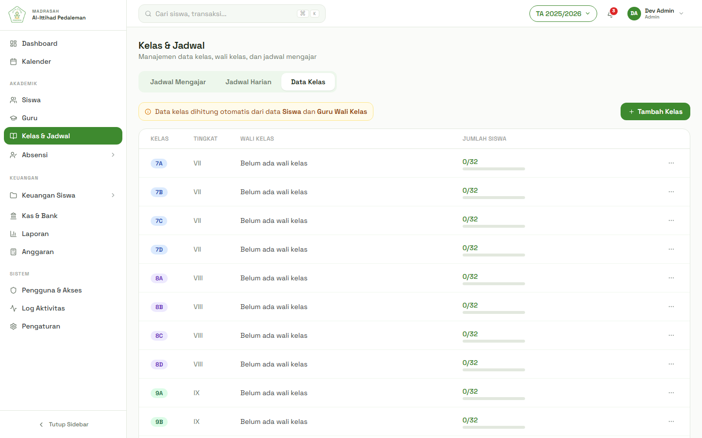
*Gambar 5.1: Tab Data Kelas, Kapasitas Rombel, dan Penugasan Wali Kelas*

Tab **Data** menampilkan semua kelas yang aktif di tahun ajaran berjalan.

| Kolom | Isi |
| --- | --- |
| **Kelas** | Nama kelas (7A, 7B, 7C, 7D, 8A – 9D) |
| **Wali Kelas** | Nama guru yang menjadi wali kelas |
| **Jumlah Siswa** | Siswa aktif terdaftar di kelas ini |
| **Kapasitas** | Batas maksimum (default dari Pengaturan: 32) |
| **Aksi** | Tombol Edit Wali Kelas |

**Menetapkan atau mengubah wali kelas:**

1. Klik **Edit** pada baris kelas yang ingin diubah
2. Pilih guru dari dropdown **Wali Kelas** (hanya guru yang aktif yang muncul)
3. Klik **Simpan**

Satu guru hanya bisa menjadi wali kelas untuk satu kelas. Jika guru yang dipilih sudah menjadi wali kelas lain, sistem akan menampilkan peringatan dan meminta konfirmasi.

### 5.2 Menyusun Jadwal Pelajaran

Tab **Jadwal** menampilkan grid jadwal per kelas.

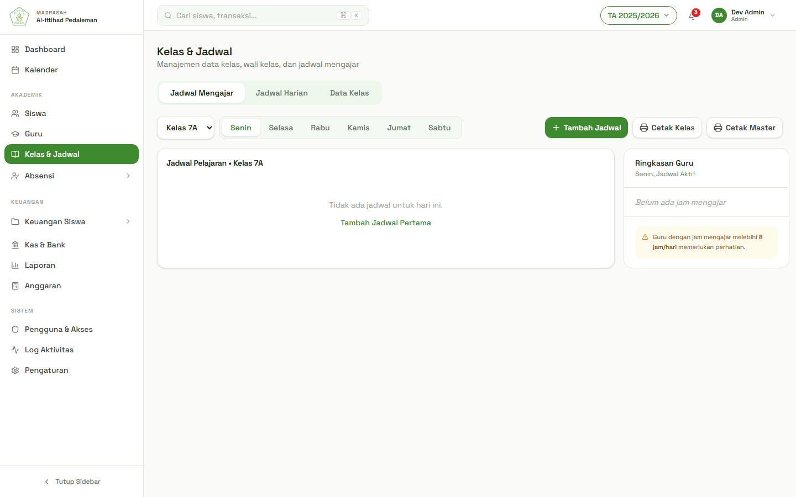
*Gambar 5.2: Matriks Jadwal Pelajaran Mingguan per Jam Pelajaran*

**Cara memilih kelas yang akan diatur jadwalnya:**

1. Pilih kelas dari dropdown di bagian atas halaman (contoh: 7A)
2. Grid jadwal untuk kelas tersebut ditampilkan dengan sumbu:
   - **Baris**: hari kerja (Senin – Jumat)
   - **Kolom**: slot jam pelajaran (Jam ke-1 hingga Jam ke-8)

**Struktur slot jam pelajaran:**

| Slot | Keterangan |
| --- | --- |
| Jam ke-1 | Pelajaran pertama |
| Jam ke-2 | Pelajaran kedua |
| Jam ke-3 | Pelajaran ketiga |
| Jam ke-4 | Pelajaran keempat |
| *Istirahat* | *Jeda otomatis setelah Jam ke-4* |
| Jam ke-5 | Pelajaran kelima |
| Jam ke-6 | Pelajaran keenam |
| Jam ke-7 | Pelajaran ketujuh |
| Jam ke-8 | Pelajaran kedelapan |

Istirahat ditampilkan sebagai pemisah visual di antara Jam ke-4 dan Jam ke-5. Slot istirahat tidak bisa diisi pelajaran.

**Mengisi slot jadwal:**

1. Klik sel kosong pada grid (perpotongan hari dan jam)
2. Form mini terbuka dengan dua field:
   - **Mata Pelajaran** \* — pilih dari daftar
   - **Guru** \* — pilih guru yang mengampu mapel tersebut
3. Klik **Simpan Slot**

**Mengubah slot yang sudah terisi:**

1. Klik sel yang sudah terisi
2. Ubah Mata Pelajaran dan/atau Guru
3. Klik **Simpan Slot**, atau klik **Hapus Slot** untuk mengosongkan

### 5.3 Deteksi Bentrok Otomatis

Sistem secara otomatis mencegah bentrok jadwal guru. **Bentrok terjadi** jika seorang guru dijadwalkan mengajar di hari dan slot jam yang sama pada dua kelas yang berbeda.

Jika terjadi bentrok, sistem menampilkan pesan:

> *"\[Nama Guru\] sudah terjadwal di \[Kelas Lain\] pada \[Hari\], \[Jam ke-X\]. Silakan pilih guru lain atau ubah jadwal \[Kelas Lain\] terlebih dahulu."*

Simpan tidak dapat dilakukan sampai bentrok diselesaikan. Tidak ada mekanisme override bentrok.

### 5.4 Salin Jadwal Antar Kelas

Jika beberapa kelas memiliki struktur jadwal yang sama (misalnya 7A dan 7B), gunakan fitur **Salin Jadwal**:

1. Atur jadwal kelas sumber terlebih dahulu (misal: 7A)
2. Klik tombol **Salin Jadwal ke Kelas Lain**
3. Pilih kelas tujuan (satu atau lebih)
4. Klik **Salin**

Sistem akan menyalin semua slot dari kelas sumber ke kelas tujuan. Jika kelas tujuan sudah memiliki jadwal, data lama akan digantikan. Jika ada slot yang menyebabkan bentrok di kelas tujuan, sistem menampilkan daftar konflik dan proses penyalinan dibatalkan.

## Bab 6 — Template & Penetapan Tagihan `[Admin]` `[Bendahara]`

Buka melalui sidebar: **Keuangan → Tagihan**, lalu pilih tab **Template** atau **Penetapan**.

> **Penting — tidak ada SPP bulanan.** Sistem ini menggunakan tiga paket tagihan tahunan. Setiap paket terdiri dari beberapa komponen. Pembayaran dialokasikan ke komponen secara otomatis berdasarkan urutan prioritas (sistem waterfall).

### 6.1 Template Tagihan

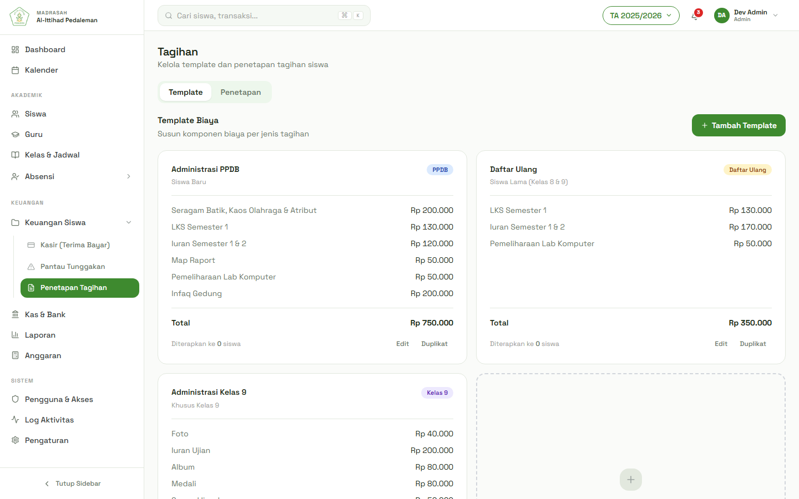
*Gambar 6.1: Template Paket Biaya (PPDB, Daftar Ulang, dan Kelas 9)*

Template mendefinisikan struktur paket tagihan. Terdapat tiga paket standar:

| Paket | Target Siswa | Total | Jumlah Komponen |
| --- | --- | --- | --- |
| **Administrasi PPDB** | Siswa baru (kelas 7) | Rp 750.000 | 6 komponen |
| **Daftar Ulang** | Kelas 8 dan Kelas 9 | Rp 350.000 | 3 komponen |
| **Administrasi Kelas 9** | Kelas 9 | Rp 700.000 | 7 komponen |

#### Melihat dan Mengedit Template

1. Klik nama paket untuk membuka detail template
2. Daftar komponen ditampilkan dalam urutan prioritas
3. Klik **Edit Template** untuk masuk ke mode pengeditan

#### Field per Komponen

| Field | Keterangan | Wajib |
| --- | --- | --- |
| **Nama Komponen** | Nama item biaya (contoh: Uang Gedung, Seragam, Buku) | \* |
| **Nominal** | Besaran biaya dalam Rupiah | \* |
| **Jatuh Tempo Default** | Tanggal batas bayar default untuk komponen ini (dd/mm/yyyy) | \* |
| **Keterangan** | Deskripsi tambahan opsional |  |

#### Mengubah Urutan Prioritas (Drag & Drop)

Urutan komponen dalam template menentukan **prioritas alokasi waterfall**. Komponen di urutan teratas mendapat alokasi pembayaran lebih dahulu.


*Gambar 6.2: Pengaturan Urutan Prioritas Waterfall Komponen Biaya*

1. Di mode edit template, arahkan kursor ke ikon ☰ di sisi kiri nama komponen
2. Klik tahan dan geser ke atas atau ke bawah
3. Lepaskan di posisi yang diinginkan
4. Urutan baru langsung tersimpan

**Contoh efek urutan waterfall:** Jika siswa membayar Rp 200.000 untuk paket PPDB (total Rp 750.000), sistem mengalokasikan Rp 200.000 ke komponen urutan pertama terlebih dahulu. Jika komponen pertama senilai Rp 150.000, sisa Rp 50.000 lanjut ke komponen kedua, dan seterusnya.

#### Menambah Komponen Baru ke Template

1. Di mode edit template, klik **+ Tambah Komponen**
2. Isi semua field komponen
3. Klik **Simpan Komponen**
4. Komponen baru muncul di urutan terakhir — atur posisinya via drag & drop jika perlu

#### Menghapus Komponen dari Template

1. Klik ikon × di sisi kanan komponen yang ingin dihapus
2. Konfirmasi pada dialog yang muncul

> **Perhatian**: Menghapus komponen dari template tidak memengaruhi tagihan yang sudah ditetapkan ke siswa. Perubahan template hanya berlaku untuk penetapan baru.

### 6.2 Penetapan Tagihan ke Siswa

Tab **Penetapan** digunakan untuk menetapkan paket tagihan kepada siswa.

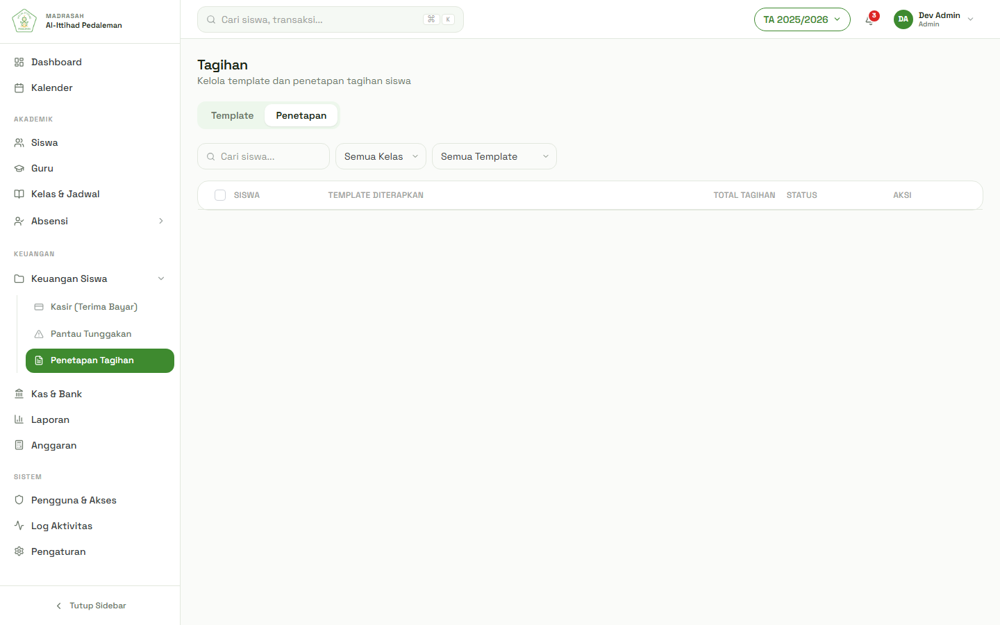
*Gambar 6.3: Penetapan Tagihan Massal per Angkatan / Kelas*

**Penetapan massal (per angkatan/kelas):**

1. Klik **+ Tetapkan Tagihan**
2. Pilih **Paket** dari dropdown (PPDB / Daftar Ulang / Administrasi Kelas 9)
3. Pilih **Target**:
   - Per angkatan: pilih kelas (7A, 7B, dst.) atau "Semua Kelas 7"
   - Per individu: cari nama/NIS siswa
4. Sistem menampilkan preview jumlah siswa yang akan dikenai tagihan
5. Klik **Tetapkan**

Sistem akan membuat tagihan untuk setiap siswa yang belum memiliki tagihan paket tersebut di tahun ajaran aktif. Siswa yang sudah memiliki tagihan paket yang sama tidak akan dikenai duplikasi.

**Penetapan individu:**

1. Cari siswa melalui kotak search
2. Klik nama siswa untuk melihat tagihan aktifnya
3. Klik **+ Tambah Tagihan**
4. Pilih paket dan konfirmasi

### 6.3 Override Jatuh Tempo per Siswa

Jatuh tempo default berasal dari template, tetapi dapat diubah untuk siswa tertentu.

1. Cari siswa di tab Penetapan
2. Klik nama siswa untuk membuka detail tagihannya
3. Klik ikon kalender di sebelah komponen yang ingin diubah jatuh temponya
4. Pilih tanggal baru (dd/mm/yyyy)
5. Klik **Simpan**

Perubahan jatuh tempo hanya berlaku untuk siswa tersebut dan tidak memengaruhi template atau siswa lain. Jatuh tempo yang diubah ditandai dengan ikon ✕ kecil di sebelahnya — klik ikon tersebut untuk mengembalikan ke default template.

## Bab 7 — Pembayaran `[Bendahara]`

Buka melalui sidebar: **Keuangan → Pembayaran**, atau tombol **Pembayaran** di bottom nav mobile.

Halaman ini adalah antarmuka kasir. Dirancang agar satu transaksi dapat diselesaikan dalam waktu kurang dari 30 detik.

### 7.1 Alur Pembayaran Standar

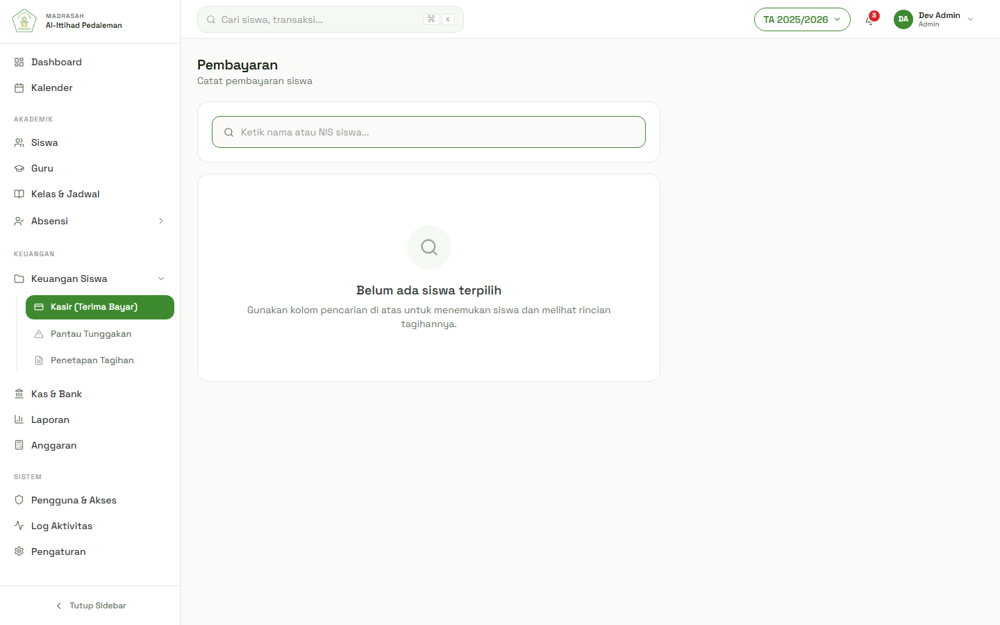
*Gambar 7.1: Antarmuka Kasir Pembayaran Siswa dan Alokasi Otomatis*

<div style="text-align: center; margin-top: 15px;">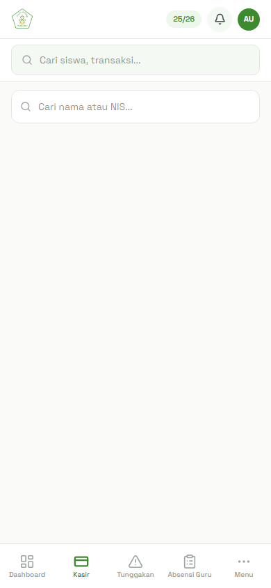
*Gambar 7.2: Tampilan Kasir Pembayaran Cepat pada Perangkat Smartphone / Tablet*</div>

**Langkah 1 — Cari Siswa**

1. Klik kotak pencarian (otomatis fokus saat halaman dibuka)
2. Ketik nama, NIS, atau NISN siswa (minimal 2 karakter)
3. Daftar pilihan muncul secara real-time
4. Klik nama siswa yang dimaksud

**Langkah 2 — Lihat Tagihan**

Setelah siswa dipilih, sistem menampilkan:

| Informasi | Keterangan |
| --- | --- |
| **Nama & Kelas** | Identitas siswa yang dipilih |
| **Paket Tagihan Aktif** | Nama paket dan total nominalnya |
| **Komponen** | Daftar semua komponen dengan status dan sisa masing-masing |
| **Total Tagihan** | Total semua paket yang belum lunas |
| **Total Sudah Dibayar** | Jumlah yang sudah diterima sebelumnya |
| **Sisa Tagihan** | Total tagihan dikurangi total sudah dibayar |

**Langkah 3 — Input Nominal Pembayaran**

| Field | Keterangan | Wajib |
| --- | --- | --- |
| **Nominal Bayar** | Jumlah uang yang diterima dari siswa/wali (Rp) | \* |
| **Metode Pembayaran** | Pilih: Tunai / Transfer BSI / Transfer Mandiri Syariah / Lainnya | \* |
| **Tanggal Pembayaran** | Default hari ini, dapat diubah ke tanggal yang lain | \* |
| **Catatan** | Keterangan tambahan opsional (contoh: titipan wali) |  |

**Langkah 4 — Konfirmasi dan Simpan**

1. Periksa ringkasan alokasi yang muncul di bawah form — sistem menampilkan ke komponen mana uang dialokasikan
2. Klik **Proses Pembayaran**
3. Sistem menyimpan transaksi dan menampilkan dialog sukses

### 7.2 Sistem Alokasi Waterfall

Nominal yang dibayar dialokasikan secara otomatis ke komponen tagihan berdasarkan **urutan prioritas** yang sudah ditetapkan di template.

**Cara kerja:**

1. Sistem membaca komponen dari urutan prioritas pertama
2. Jika nominal cukup untuk melunasi komponen tersebut, komponen tandai Lunas, sisa uang lanjut ke komponen berikutnya
3. Jika nominal tidak cukup, komponen menjadi Mencicil dengan nilai yang dibayar, alokasi berhenti
4. Komponen yang belum mendapat alokasi tetap Menunggak

**Contoh:** Tagihan PPDB Rp 750.000 dengan 6 komponen (masing-masing Rp 125.000). Siswa bayar Rp 300.000:

- Komponen 1 (Rp 125.000): **Lunas** ✔
- Komponen 2 (Rp 125.000): **Lunas** ✔
- Komponen 3 (Rp 125.000): Mencicil — baru dibayar Rp 50.000 (sisa Rp 75.000)
- Komponen 4, 5, 6: Menunggak

Urutan prioritas tidak dapat diubah dari halaman kasir — ubah melalui Keuangan → Tagihan → Template.

### 7.3 Cicilan

Sistem mendukung pembayaran cicilan tanpa konfigurasi tambahan. Setiap kali siswa membayar sebagian, cukup ulangi alur di 7.1 dengan nominal yang dibayarkan saat itu.

Status tagihan akan berubah otomatis:

- Belum ada pembayaran → **Menunggak**
- Ada pembayaran, belum lunas semua komponen → **Mencicil**
- Semua komponen lunas → **Lunas**

### 7.4 Kuitansi

Setelah transaksi berhasil, dialog sukses menampilkan dua opsi:

#### Cetak Kuitansi

1. Klik **Cetak Kuitansi** pada dialog sukses
2. Tampilan cetak muncul dengan:
   - Kop madrasah (dari Pengaturan Identitas Madrasah)
   - Nomor kuitansi otomatis (format KW/{TAHUN}/{BULAN}/{URUT})
   - Nama siswa, kelas, tanggal pembayaran
   - Rincian komponen yang dibayar dan nominalnya
   - Total yang diterima
   - Kolom tanda tangan bendahara
3. Gunakan fungsi cetak browser (Ctrl+P) atau klik **Cetak**

#### Kirim via WhatsApp

1. Klik **Kirim WhatsApp** pada dialog sukses
2. Browser membuka WhatsApp Web (atau aplikasi WA di mobile) dengan nomor wali siswa sudah terisi
3. Pesan berisi ringkasan pembayaran sudah tertulis otomatis di kolom chat:
   - Nama siswa
   - Tanggal dan nominal pembayaran
   - Rincian komponen yang dilunasi
   - Sisa tagihan (jika masih ada)
4. Klik **Kirim** di WhatsApp

> **Catatan**: Fitur kirim WA tidak menggunakan API WhatsApp berbayar. Sistem hanya menyiapkan link `wa.me` dengan teks yang sudah diformat. Nomor wali diambil dari data siswa — pastikan nomor WA wali sudah diisi dengan benar di profil siswa.

### 7.5 Pembatalan Transaksi (Reversal)

Transaksi keuangan **tidak dapat dihapus**. Pembatalan dilakukan melalui mekanisme reversal yang membuat entri baru untuk mengoreksi kesalahan.

**Kapan menggunakan reversal:**

- Nominal yang dimasukkan salah
- Siswa yang dipilih salah
- Pembayaran batal (cek/transfer tidak jadi)

**Langkah reversal:**

1. Buka halaman Pembayaran
2. Klik tab **Riwayat Transaksi**
3. Cari transaksi yang ingin dibatalkan (filter berdasarkan tanggal atau nama siswa)
4. Klik **Batalkan** di baris transaksi tersebut
5. Isi form pembatalan:
   - **Alasan Pembatalan** \* — wajib diisi, minimal 10 karakter (contoh: "Salah input nominal, seharusnya Rp 200.000")
6. Klik **Konfirmasi Pembatalan**

Sistem mencatat dua entri di Log Aktivitas:

- Entri reversal dengan referensi ke transaksi asal
- Catatan alasan yang diisi bendahara

Saldo siswa otomatis dikembalikan ke kondisi sebelum transaksi dibatalkan.

## Bab 8 — Tunggakan `[Bendahara]` `[Admin]`

Buka melalui sidebar: **Keuangan → Tunggakan**.

Halaman ini menampilkan semua siswa yang memiliki tagihan belum lunas, lengkap dengan informasi aging (usia tunggakan sejak jatuh tempo).

### 8.1 Daftar Tunggakan

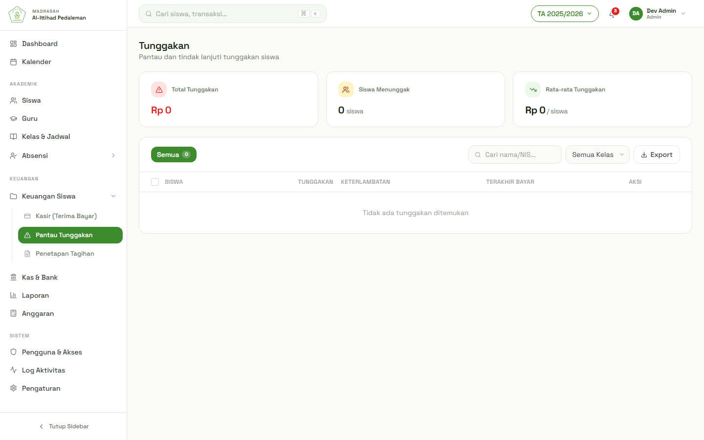
*Gambar 8.1: Daftar Tunggakan Siswa dengan Status Aging (Perhatian, Waspada, Kritis)*

Kolom-kolom tabel tunggakan:

| Kolom | Isi |
| --- | --- |
| **Nama Siswa** | Nama lengkap siswa |
| **Kelas** | Kelas siswa saat ini |
| **Paket** | Nama paket tagihan yang menunggak |
| **Total Tagihan** | Jumlah total paket tersebut |
| **Sudah Dibayar** | Jumlah yang sudah diterima |
| **Sisa** | Selisih yang belum dibayar |
| **Jatuh Tempo** | Tanggal jatuh tempo komponen tertua yang belum lunas |
| **Aging** | Status usia tunggakan (Perhatian / Waspada / Kritis) |
| **Aksi** | Tombol Detail dan Kirim WA |

### 8.2 Memahami Aging Tunggakan

Aging dihitung otomatis berdasarkan selisih hari antara **tanggal hari ini** dan **jatuh tempo** komponen yang belum lunas.

| Status Aging | Kondisi | Warna |
| --- | --- | --- |
| **Perhatian** | Lewat jatuh tempo 1 – 30 hari | Kuning/Amber |
| **Waspada** | Lewat jatuh tempo 31 – 60 hari | Oranye |
| **Kritis** | Lewat jatuh tempo lebih dari 60 hari | Merah |

Jika siswa memiliki beberapa komponen yang menunggak, status aging mengikuti komponen yang **paling lama melewati jatuh tempo**.

Tagihan yang belum melewati jatuh tempo tidak muncul di halaman ini sebagai tunggakan (statusnya masih Mencicil atau Menunggak di halaman siswa, tetapi tidak dihitung sebagai aging).

### 8.3 Filter dan Pencarian

Filter yang tersedia di atas tabel:

| Filter | Pilihan |
| --- | --- |
| **Cari** | Nama atau NIS siswa |
| **Aging** | Semua / Perhatian / Waspada / Kritis |
| **Kelas** | Semua kelas / 7A / 7B / ... / 9D |
| **Paket** | Semua / PPDB / Daftar Ulang / Administrasi Kelas 9 |

Jumlah hasil mengikuti filter aktif. Badge angka di menu sidebar **Tunggakan** juga mengikuti total siswa yang menunggak.

### 8.4 Kirim Notifikasi WhatsApp ke Wali

**Kirim satu per satu:**

1. Pada baris siswa, klik tombol **WA** (ikon WhatsApp)
2. Browser membuka WhatsApp Web atau aplikasi WA dengan:
   - Nomor wali siswa sudah terisi
   - Pesan pengingat tunggakan sudah diformat otomatis (nama siswa, paket, sisa tagihan, jatuh tempo)
3. Periksa pesan, lalu klik **Kirim** di WhatsApp

**Kirim massal (semua hasil filter):**

1. Terapkan filter yang diinginkan (misal: semua kelas 9, aging Kritis)
2. Klik tombol **Kirim WA ke Semua**
3. Sistem menampilkan konfirmasi jumlah siswa yang akan dikirim
4. Klik **Lanjutkan**
5. Browser akan membuka tab WA satu per satu untuk setiap siswa (pastikan pop-up browser tidak diblokir)

> **Catatan**: Fitur ini menggunakan link `wa.me` tanpa API berbayar. Setiap pengiriman memerlukan klik manual di WhatsApp — sistem tidak bisa mengirim otomatis tanpa tindakan pengguna.

### 8.5 Tindak Lanjut Tunggakan

Setelah siswa melakukan pembayaran, proses pembayaran dilakukan melalui halaman **Keuangan → Pembayaran** (lihat Bab 7). Status aging di halaman Tunggakan akan diperbarui otomatis setelah transaksi tersimpan.

## Bab 9 — Absensi `[TU]`

Buka melalui sidebar: **Akademik → Absensi**, lalu pilih tab **Hari Ini** atau **Rekapitulasi**.

### 9.1 Absensi Hari Ini

Digunakan untuk mencatat kehadiran siswa setiap hari sekolah.


*Gambar 9.1: Pencatatan Presensi Harian Siswa & Guru*

**Langkah mencatat absensi:**

1. Pilih **Kelas** dari dropdown (7A – 9D)
2. Daftar siswa di kelas tersebut muncul lengkap
3. Untuk setiap siswa, pilih status kehadiran menggunakan tombol toggle:

| Status | Arti | Warna Badge |
| --- | --- | --- |
| **Hadir** | Siswa masuk sekolah tepat waktu | Hijau |
| **Terlambat** | Siswa masuk setelah jam masuk standar (lihat 9.2) | Hijau (dengan catatan) |
| **Izin** | Siswa tidak masuk dengan keterangan | Kuning/Amber |
| **Alpa** | Siswa tidak masuk tanpa keterangan | Merah |

4. Untuk status **Izin**, isi field **Keterangan** yang muncul (contoh: sakit, keperluan keluarga)
5. Setelah semua siswa diisi, klik **Simpan Absensi Kelas \[Nama Kelas\]**

Absensi bisa disimpan sebagian dan dilanjutkan nanti. Sistem menandai kelas yang absensinya sudah lengkap dengan centang hijau di dropdown pemilih kelas.

**Mengedit absensi yang sudah disimpan:**

Absensi hari yang sama masih bisa diubah sebelum pukul 23:59 hari tersebut. Setelah tengah malam, data terkunci dan hanya Admin yang dapat melakukan koreksi melalui Log Aktivitas.

### 9.2 Ketentuan Terlambat (Otomatis)

Sistem menentukan Terlambat secara otomatis berdasarkan jam masuk standar yang diatur di **Sistem → Pengaturan**. Default: **07.00**.

Bagaimana cara mencatat siswa terlambat:

1. Pilih status **Terlambat** pada toggle siswa yang bersangkutan
2. Field **Jam Masuk Aktual** muncul — isi dengan jam siswa benar-benar masuk (contoh: 07.25)
3. Sistem otomatis mencatat selisih keterlambatan

> **Penting**: Status Terlambat tetap dihitung sebagai **Hadir** dalam perhitungan persentase kehadiran. Terlambat bukan ketidakhadiran.

### 9.3 Rekapitulasi Absensi

Tab **Rekapitulasi** menampilkan ringkasan kehadiran dalam rentang tanggal tertentu.

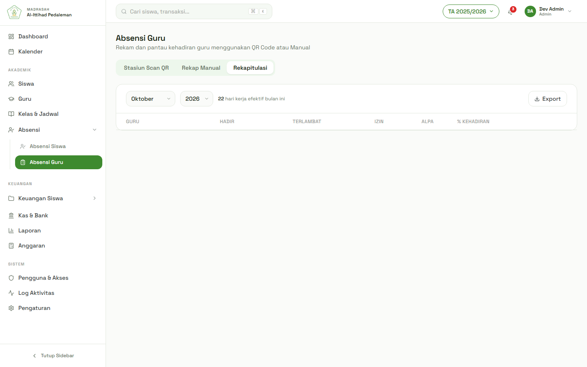
*Gambar 9.2: Rekapitulasi Kehadiran Bulanan dan Persentase Presensi*

**Filter yang tersedia:**

| Filter | Pilihan |
| --- | --- |
| **Periode** | Pilih rentang tanggal mulai dan selesai |
| **Kelas** | Semua kelas / pilih kelas tertentu |
| **Siswa** | Cari siswa tertentu (opsional) |
| **Status** | Semua / Hadir / Terlambat / Izin / Alpa |

**Kolom-kolom tabel rekapitulasi:**

| Kolom | Isi |
| --- | --- |
| **Nama Siswa** | Nama lengkap |
| **Kelas** | Kelas siswa |
| **Hadir** | Jumlah hari hadir (termasuk terlambat) |
| **Terlambat** | Jumlah hari terlambat |
| **Izin** | Jumlah hari izin |
| **Alpa** | Jumlah hari alpa |
| **Hari Efektif** | Total hari sekolah dalam periode yang dipilih |
| **% Kehadiran** | Hadir ÷ Hari Efektif × 100% |

**Formula % Kehadiran:**

```
% Kehadiran = Jumlah Hari Hadir (termasuk Terlambat) ÷ Hari Kerja Efektif × 100%
```

Hari kerja efektif = total hari sekolah dalam periode, tidak termasuk hari libur yang tercatat di Kalender.

**Cetak / Export Rekap:**

1. Terapkan filter yang diinginkan
2. Klik tombol **Export PDF** atau **Export Excel**
3. File akan diunduh ke perangkat Anda

### 9.4 Absensi Guru

Absensi guru dicatat melalui jalur yang sama di tab **Hari Ini**, dengan memilih tab **Guru** di atas daftar.

Status absensi guru sama dengan siswa: Hadir / Terlambat / Izin / Alpa.

Field tambahan untuk guru:

| Field | Keterangan |
| --- | --- |
| **Nama Guru** | Nama lengkap guru |
| **Jam Masuk Aktual** | Diisi jika status Terlambat |
| **Keterangan** | Wajib diisi jika Izin |

Rekap absensi guru tersedia di tab Rekapitulasi dengan filter **Tipe: Guru**.

## Bab 10 — Kas & Bank `[Bendahara]` `[Admin]`

Buka melalui sidebar: **Keuangan → Kas & Bank**, lalu pilih tab **Transaksi**, **Akun**, atau **Mutasi**.

### 10.1 Daftar Transaksi

Tab **Transaksi** menampilkan seluruh arus keuangan madrasah dalam satu ledger terpadu.

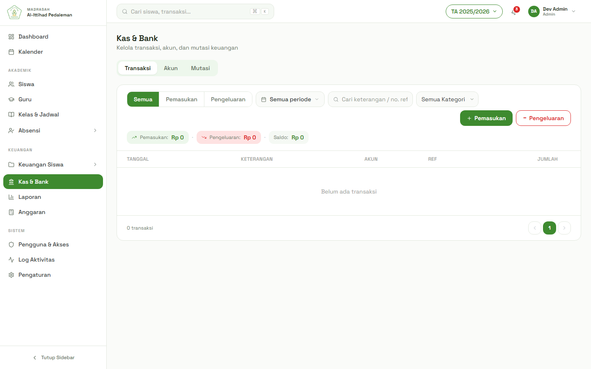
*Gambar 10.1: Buku Transaksi Kas & Bank Terpadu*

Kolom-kolom tabel transaksi:

| Kolom | Isi |
| --- | --- |
| **Tanggal** | Tanggal transaksi (dd/mm/yyyy) |
| **No. Referensi** | Nomor unik transaksi. Otomatis dari pembayaran siswa (format KW/…) atau manual (format BV/… untuk pengeluaran, atau “—” untuk entry penyesuaian) |
| **Keterangan** | Deskripsi transaksi |
| **Akun** | Akun kas/bank yang terlibat (BSI, Mandiri Syariah, atau Kas Tunai) |
| **Debet** | Uang masuk (Rp) — rata kanan |
| **Kredit** | Uang keluar (Rp) — rata kanan |
| **Saldo** | Saldo akun berjalan setelah transaksi ini |

**Filter transaksi:**

| Filter | Pilihan |
| --- | --- |
| **Periode** | Rentang tanggal mulai dan selesai |
| **Akun** | Semua akun / pilih akun tertentu |
| **Jenis** | Semua / Debet / Kredit |
| **Sumber** | Semua / Otomatis (dari pembayaran) / Manual |

### 10.2 Input Transaksi Manual

Digunakan untuk mencatat pengeluaran, penerimaan non-tagihan siswa, atau penyesuaian saldo.

1. Klik **+ Tambah Transaksi**
2. Isi form:

| Field | Keterangan | Wajib |
| --- | --- | --- |
| **Tanggal** | Tanggal transaksi berlangsung (dd/mm/yyyy) | \* |
| **Jenis** | Pilih: Debet (uang masuk) atau Kredit (uang keluar) | \* |
| **Akun** | Pilih akun yang terlibat (BSI / Mandiri Syariah / Kas Tunai) | \* |
| **Kategori** | Pilih kategori pengeluaran/penerimaan (sesuai RAB) | \* |
| **Keterangan** | Deskripsi singkat transaksi (contoh: Pembelian ATK, Biaya Listrik) | \* |
| **Nominal** | Jumlah uang dalam Rupiah | \* |
| **No. Bukti** | Nomor kwitansi/faktur/nota (akan menjadi No. Referensi di ledger) |  |
| **Catatan** | Keterangan tambahan opsional |  |

3. Klik **Simpan**

Transaksi manual otomatis tercatat di Log Aktivitas dengan nama operator yang menginput.

Transaksi manual **tidak dapat dihapus**. Jika salah, lakukan koreksi dengan membuat transaksi kebalikan (Debet jika sebelumnya Kredit, atau sebaliknya) dengan keterangan yang jelas, dan laporkan di Log Aktivitas.

### 10.3 Tab Akun

Menunjukkan ringkasan saldo setiap akun kas dan bank.


*Gambar 10.2: Ringkasan Saldo Berjalan per Rekening Bank dan Kas Tunai*

| Kolom | Isi |
| --- | --- |
| **Nama Akun** | Nama akun (BSI, Mandiri Syariah, Kas Tunai) |
| **Jenis** | Bank atau Tunai |
| **Saldo Awal** | Saldo saat akun pertama kali ditambahkan |
| **Total Debet** | Total uang masuk sepanjang periode |
| **Total Kredit** | Total uang keluar sepanjang periode |
| **Saldo Saat Ini** | Saldo Awal + Total Debet − Total Kredit |

Untuk menambah atau menonaktifkan akun, lihat Bab 2.4.

### 10.4 Tab Mutasi

Menunjukkan mutasi (pergerakan saldo) per akun dalam bentuk laporan ringkas, berguna untuk rekonsiliasi dengan rekening koran bank.

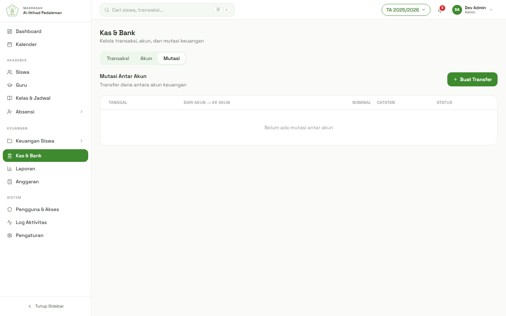
*Gambar 10.3: Laporan Mutasi dan Perpindahan Saldo Antar Akun*

1. Pilih **Akun** yang ingin dilihat mutasinya
2. Pilih **Periode** (rentang tanggal)
3. Tabel mutasi ditampilkan dengan kolom: Tanggal, Keterangan, Referensi, Debet, Kredit, Saldo
4. Klik **Export PDF** atau **Export Excel** untuk mengunduh rekap mutasi

## Bab 11 — Anggaran `[Bendahara]` `[Admin]`

Buka melalui sidebar: **Keuangan → Anggaran**, lalu pilih tab **RAB** atau **Realisasi**.

### 11.1 Rencana Anggaran Belanja (RAB)

RAB adalah daftar rencana pengeluaran dan penerimaan madrasah untuk satu tahun ajaran.

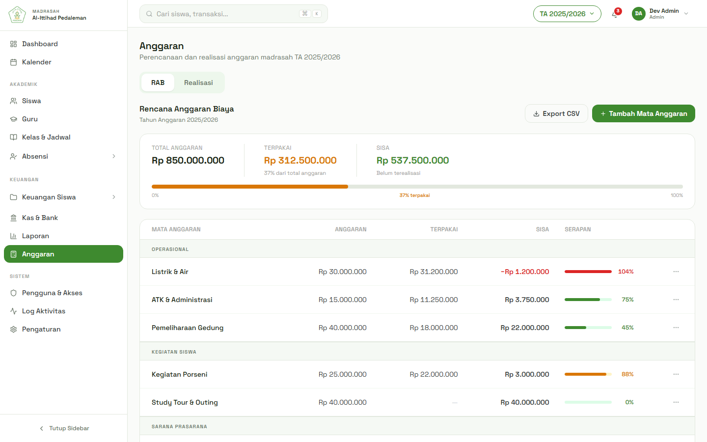
*Gambar 11.1: Rencana Anggaran Biaya (RAB) per Program & Kegiatan*

#### Menyusun RAB

1. Klik **+ Tambah Program** untuk membuat kelompok anggaran baru
2. Isi field program:

| Field | Keterangan | Wajib |
| --- | --- | --- |
| **Nama Program** | Nama kelompok kegiatan (contoh: Pengembangan SDM, Operasional Madrasah) | \* |
| **Kode Program** | Kode singkat untuk pengelompokan laporan (contoh: SDM, OPS) | \* |

3. Di dalam program, klik **+ Tambah Kegiatan** untuk menambah rincian:

| Field | Keterangan | Wajib |
| --- | --- | --- |
| **Nama Kegiatan** | Nama kegiatan spesifik (contoh: Pelatihan Guru, Pembelian ATK) | \* |
| **Jenis** | Pilih: Pengeluaran atau Penerimaan | \* |
| **Sumber Dana** | Pilih: Dana BOS / Komite / Yayasan / Lainnya | \* |
| **Nominal Rencana** | Jumlah yang direncanakan dalam Rupiah | \* |
| **Keterangan** | Penjelasan tambahan opsional |  |

4. Klik **Simpan Kegiatan**
5. Ulangi untuk semua kegiatan dalam program tersebut

**Mengedit atau menghapus kegiatan RAB:**

- Klik ikon pensil di baris kegiatan untuk mengedit
- Klik ikon × untuk menghapus (hanya bisa dihapus jika belum ada realisasi yang terkait)

### 11.2 Realisasi Anggaran

Tab **Realisasi** membandingkan rencana (RAB) dengan pengeluaran/penerimaan aktual dari ledger Kas & Bank.

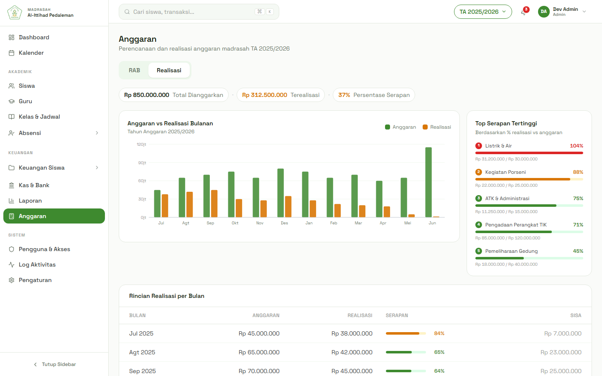
*Gambar 11.2: Monitoring Realisasi Anggaran dan Peringatan Over-Budget*

Kolom-kolom tabel realisasi:

| Kolom | Isi |
| --- | --- |
| **Program / Kegiatan** | Nama program dan rincian kegiatan |
| **Jenis** | Pengeluaran atau Penerimaan |
| **Sumber Dana** | Dana BOS / Komite / Yayasan / Lainnya |
| **Rencana (RAB)** | Nominal yang direncanakan |
| **Realisasi** | Total transaksi aktual yang dikaitkan ke kegiatan ini |
| **Selisih** | Rencana dikurangi Realisasi (positif = di bawah anggaran, negatif = melebihi) |
| **% Serapan** | Realisasi ÷ Rencana × 100% |

**Mengaitkan transaksi ke kegiatan RAB:**

Setiap transaksi manual di Kas & Bank memiliki field **Kategori** yang terhubung ke kegiatan RAB. Realisasi dihitung otomatis dari akumulasi transaksi yang dikaitkan ke masing-masing kegiatan.

**Mengunduh laporan realisasi:**

1. Pilih **Periode** yang ingin dilaporkan
2. Pilih **Sumber Dana** (opsional)
3. Klik **Export PDF** untuk laporan siap cetak, atau **Export Excel** untuk diolah lebih lanjut

## Bab 12 — Laporan Keuangan `[Bendahara]` `[Admin]`

Buka melalui sidebar: **Keuangan → Laporan**, lalu pilih jenis laporan dari tab yang tersedia.

### 12.1 Buku Kas Umum (BKU)

BKU adalah laporan kronologis seluruh arus kas madrasah, diurutkan berdasarkan tanggal transaksi.

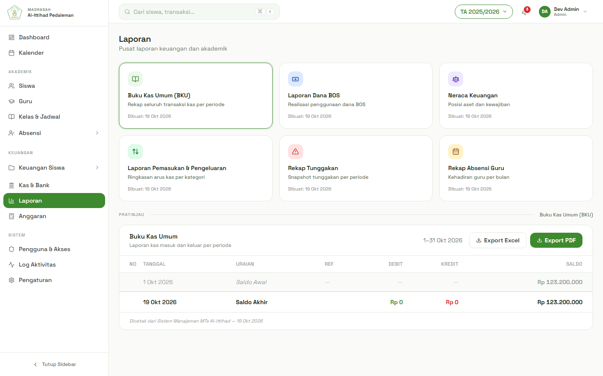
*Gambar 12.1: Buku Kas Umum (BKU) dengan Saldo Berjalan Kronologis*

**Parameter laporan:**

| Field | Keterangan | Wajib |
| --- | --- | --- |
| **Periode** | Pilih bulan dan tahun, atau rentang tanggal custom | \* |
| **Akun** | Semua akun atau pilih akun tertentu |  |

**Kolom BKU:**

| Kolom | Isi |
| --- | --- |
| **No.** | Nomor urut baris |
| **Tanggal** | Tanggal transaksi |
| **No. Bukti** | Nomor referensi (kuitansi/BV/—) |
| **Uraian** | Keterangan transaksi |
| **Penerimaan** | Uang masuk (Rp) |
| **Pengeluaran** | Uang keluar (Rp) |
| **Saldo** | Saldo berjalan |

BKU dimulai dengan baris **Saldo Awal** di atas dan diakhiri baris **Saldo Akhir** di bawah.

**Mengunduh BKU:**

1. Pilih periode
2. Klik **Export PDF** untuk laporan berformat resmi siap tanda tangan, atau **Export Excel** untuk pengolahan data

### 12.2 Laporan Dana BOS

Laporan khusus untuk pertanggungjawaban dana Bantuan Operasional Sekolah (BOS).

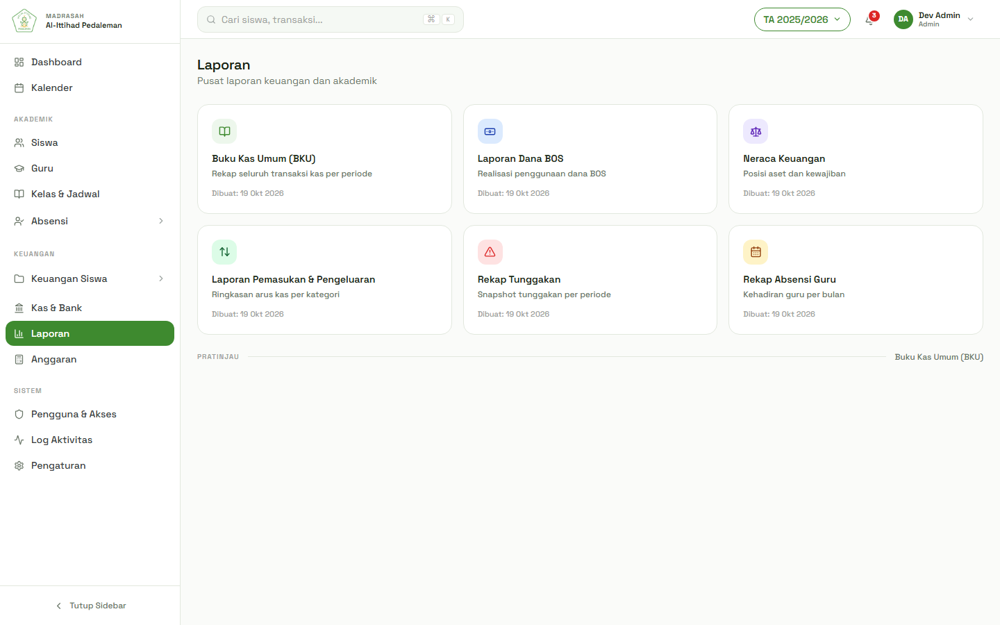
*Gambar 12.2: Laporan Pertanggungjawaban Realisasi Dana BOS*

**Parameter laporan:**

| Field | Keterangan | Wajib |
| --- | --- | --- |
| **Triwulan** | Pilih Triwulan 1 / 2 / 3 / 4 | \* |
| **Tahun** | Tahun anggaran | \* |

Laporan Dana BOS menampilkan:

- Saldo awal dana BOS
- Rincian penerimaan dana BOS
- Rincian penggunaan per komponen (sesuai juknis BOS)
- Saldo akhir

Format laporan menyesuaikan format resmi Kementerian Agama. Pastikan setiap transaksi yang menggunakan dana BOS sudah dikategorikan dengan benar saat input di Kas & Bank.

### 12.3 Neraca

Neraca menampilkan posisi keuangan madrasah pada tanggal tertentu (total aset, kewajiban, dan ekuitas).

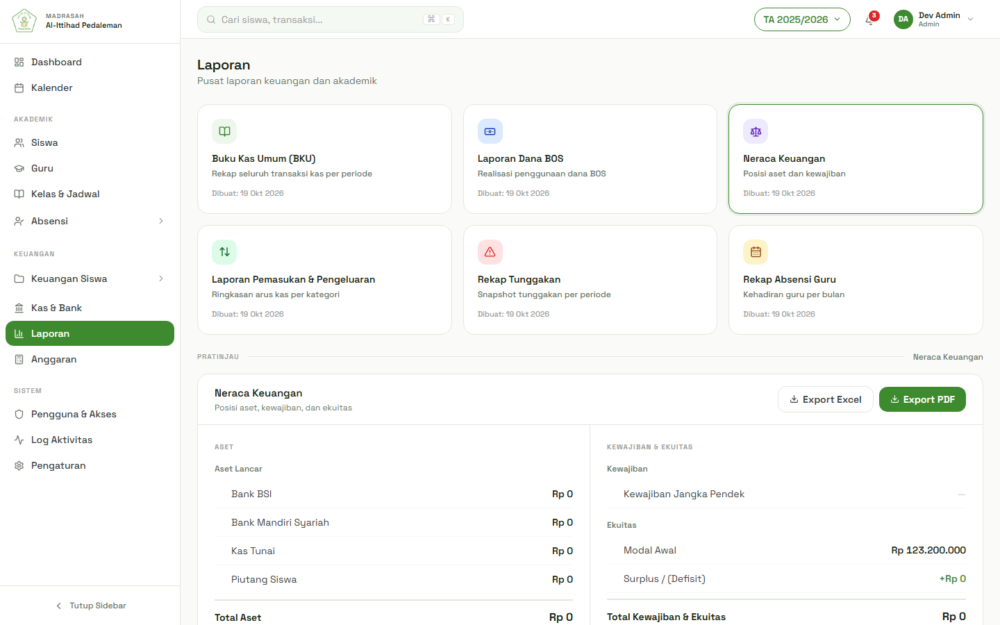
*Gambar 12.3: Laporan Neraca Keuangan Madrasah (Aset vs Kewajiban)*

**Parameter laporan:**

| Field | Keterangan | Wajib |
| --- | --- | --- |
| **Per Tanggal** | Tanggal neraca yang ingin dilihat (dd/mm/yyyy) | \* |

Neraca ditampilkan dalam dua kolom:

| Sisi Kiri (Aset) | Sisi Kanan (Kewajiban + Ekuitas) |
| --- | --- |
| Kas Tunai | Kewajiban jangka pendek |
| Rekening BSI | Kewajiban jangka panjang |
| Rekening Mandiri Syariah | Ekuitas / Dana Madrasah |
| Aset lainnya |  |

### 12.4 Laporan Penerimaan Siswa

Laporan ringkasan semua pembayaran yang diterima dari siswa dalam periode tertentu.

**Parameter laporan:**

| Field | Keterangan | Wajib |
| --- | --- | --- |
| **Periode** | Rentang tanggal | \* |
| **Kelas** | Semua kelas atau kelas tertentu |  |
| **Paket** | Semua paket atau paket tertentu |  |

Laporan menampilkan rincian: nama siswa, kelas, paket, komponen, tanggal bayar, nominal, metode pembayaran, dan nomor kuitansi.

### 12.5 Cara Export dan Cetak

Semua laporan mendukung dua format unduhan:

| Format | Kegunaan |
| --- | --- |
| **Export PDF** | Laporan siap cetak dengan kop madrasah, format resmi, kolom tanda tangan |
| **Export Excel** | Data mentah untuk rekonsiliasi atau pengolahan lebih lanjut |

**Langkah umum export:**

1. Pilih jenis laporan dari tab
2. Isi parameter (periode, filter)
3. Klik **Tampilkan** untuk pratinjau di layar
4. Klik **Export PDF** atau **Export Excel**
5. File diunduh otomatis ke folder unduhan perangkat Anda

PDF menggunakan identitas madrasah dari **Sistem → Pengaturan → Identitas Madrasah**. Pastikan data identitas sudah lengkap sebelum mencetak laporan resmi.

## Bab 13 — Kalender

Buka melalui sidebar: **Akademik → Kalender** (atau klik ikon kalender di header).

Kalender madrasah digunakan untuk mencatat agenda, hari libur, dan kegiatan sekolah. Data kalender memengaruhi perhitungan **hari kerja efektif** pada rekapitulasi absensi.

### 13.1 Tampilan Kalender

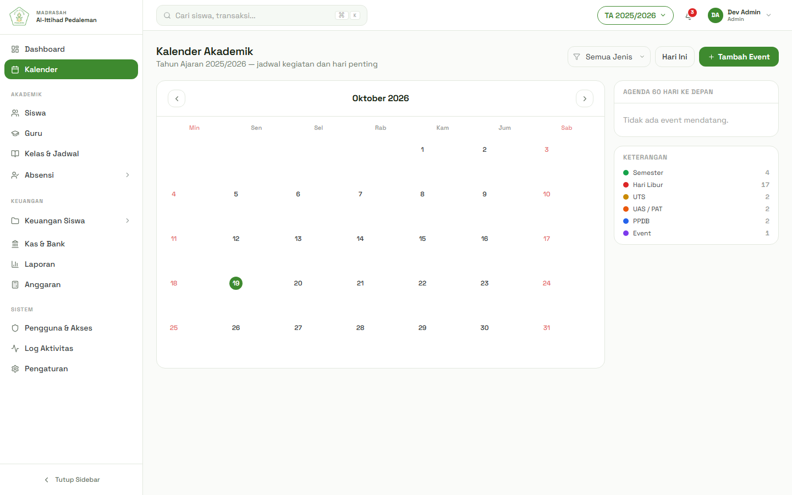
*Gambar 13.1: Kalender Akademik Madrasah dan Penandaan Hari Libur*

Kalender ditampilkan dalam tampilan bulanan. Setiap event ditandai dengan titik atau blok warna sesuai kategorinya. Klik tanggal tertentu untuk melihat daftar event pada hari tersebut.

**Navigasi:**

- Klik **< Sebelumnya** dan **Berikutnya >** untuk berpindah bulan
- Klik **Hari Ini** untuk kembali ke bulan saat ini
- Gunakan dropdown **Bulan / Tahun** untuk loncat ke periode tertentu

### 13.2 Menambah Event

1. Klik tanggal pada kalender, atau klik tombol **+ Tambah Event**
2. Isi form:

| Field | Keterangan | Wajib |
| --- | --- | --- |
| **Judul Event** | Nama kegiatan atau keterangan hari libur (contoh: Libur Maulid Nabi, Ujian Semester) | \* |
| **Tanggal Mulai** | Tanggal pertama event (dd/mm/yyyy) | \* |
| **Tanggal Selesai** | Tanggal terakhir event — isi sama dengan Tanggal Mulai jika event satu hari | \* |
| **Kategori** | Pilih kategori (lihat tabel di bawah) | \* |
| **Keterangan** | Deskripsi tambahan opsional |  |

**Kategori event yang tersedia:**

| Kategori | Warna | Efek pada Absensi |
| --- | --- | --- |
| **Hari Libur Nasional** | Merah | Dikecualikan dari hari kerja efektif |
| **Libur Madrasah** | Oranye | Dikecualikan dari hari kerja efektif |
| **Ujian** | Ungu | Tetap dihitung hari kerja efektif |
| **Kegiatan Madrasah** | Biru | Tetap dihitung hari kerja efektif |
| **Pengumuman** | Hijau | Tidak memengaruhi absensi |

3. Klik **Simpan**

Event yang mencakup beberapa hari akan ditampilkan sebagai blok memanjang di kalender.

### 13.3 Edit dan Hapus Event

**Edit:**

1. Klik event di kalender
2. Klik **Edit** pada popup detail event
3. Ubah field yang perlu diubah
4. Klik **Simpan**

**Hapus:**

1. Klik event di kalender
2. Klik **Hapus** pada popup detail event
3. Konfirmasi pada dialog yang muncul

> **Catatan**: Menghapus event Hari Libur atau Libur Madrasah akan mengubah jumlah hari kerja efektif secara retroaktif, yang berdampak pada persentase kehadiran siswa yang sudah tersimpan. Pastikan penghapusan memang diperlukan sebelum mengkonfirmasi.

## Bab 14 — Sistem `[Admin]`

Buka melalui sidebar: **Sistem**, lalu pilih submenu **Pengguna**, **Log Aktivitas**, atau **Pengaturan**.

### 14.1 Manajemen Pengguna

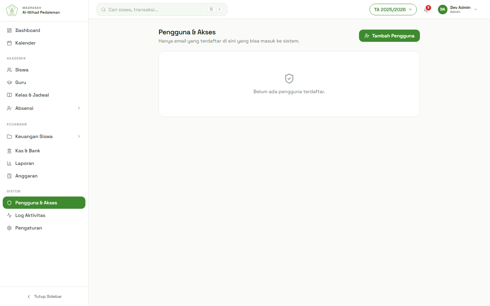
*Gambar 14.1: Manajemen Akun Pengguna dan Penetapan Hak Akses (Role)*

Halaman ini mengelola semua akun yang dapat masuk ke aplikasi.

Kolom-kolom tabel pengguna:

| Kolom | Isi |
| --- | --- |
| **Username** | Nama login pengguna |
| **Nama Lengkap** | Nama sebenarnya |
| **Peran** | Admin / Bendahara / TU |
| **Status** | Aktif / Nonaktif |
| **Terakhir Login** | Waktu terakhir pengguna mengakses aplikasi |
| **Aksi** | Edit, Reset Password, Nonaktifkan |

#### Tambah Pengguna Baru

1. Klik **+ Tambah Pengguna**
2. Isi form:

| Field | Keterangan | Wajib |
| --- | --- | --- |
| **Nama Lengkap** | Nama lengkap pengguna | \* |
| **Username** | Nama login, huruf kecil tanpa spasi (contoh: bendahara1, tu.ahmad) | \* |
| **Peran** | Pilih: Admin / Bendahara / TU | \* |
| **Password** | Password awal, minimal 8 karakter | \* |
| **Konfirmasi Password** | Ketik ulang password | \* |
| **Email** | Alamat email untuk notifikasi sistem (opsional) |  |

3. Klik **Simpan**

Sarankan pengguna baru segera mengganti password setelah login pertama (lihat Bab 1.3).

#### Edit Data Pengguna

1. Klik **Edit** pada baris pengguna
2. Ubah Nama Lengkap, Peran, atau Email sesuai kebutuhan
3. Klik **Simpan**

> **Perhatian**: Mengubah Peran pengguna langsung berlaku pada sesi login berikutnya. Jika pengguna sedang login saat peran diubah, perubahan baru efektif setelah mereka logout dan login kembali.

#### Reset Password

1. Klik **Reset Password** pada baris pengguna
2. Isi password baru (minimal 8 karakter)
3. Isi konfirmasi password
4. Klik **Reset**

Komunikasikan password baru kepada pengguna yang bersangkutan. Sistem tidak mengirim notifikasi otomatis.

#### Nonaktifkan Pengguna

1. Klik **Nonaktifkan** pada baris pengguna
2. Konfirmasi pada dialog

Pengguna yang dinonaktifkan tidak dapat login. Data dan riwayat aktivitasnya tetap tersimpan. Untuk mengaktifkan kembali, klik **Aktifkan** pada baris pengguna tersebut.

### 14.2 Log Aktivitas

Log Aktivitas mencatat semua tindakan signifikan yang dilakukan oleh seluruh pengguna. Log ini tidak dapat diubah atau dihapus.

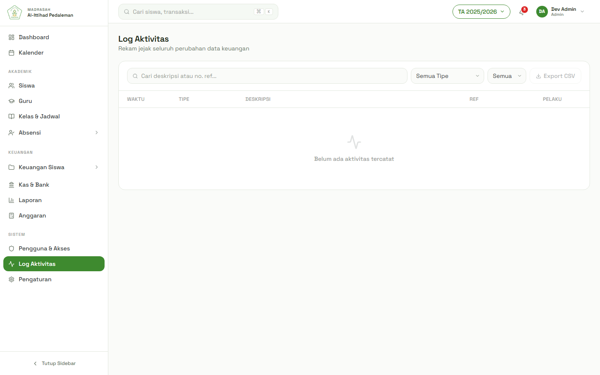
*Gambar 14.2: Rekam Jejak Audit Trail dan Riwayat Aktivitas Sistem*

Kolom-kolom tabel log:

| Kolom | Isi |
| --- | --- |
| **Waktu** | Tanggal dan jam tindakan dilakukan |
| **Pengguna** | Nama pengguna yang melakukan tindakan |
| **Tindakan** | Jenis tindakan (Tambah / Ubah / Hapus / Pembayaran / Reversal / Login / dst.) |
| **Modul** | Bagian aplikasi yang terlibat (Siswa / Pembayaran / Absensi / dst.) |
| **Detail** | Ringkasan perubahan atau data yang terpengaruh |
| **IP Address** | Alamat IP perangkat yang digunakan |

**Filter log:**

| Filter | Pilihan |
| --- | --- |
| **Periode** | Rentang tanggal |
| **Pengguna** | Pilih pengguna tertentu atau semua |
| **Tindakan** | Semua / Pembayaran / Reversal / Login / Perubahan Data |
| **Modul** | Semua modul atau modul tertentu |

**Membaca entri reversal:**

Entri reversal ditandai dengan jenis tindakan **Reversal** dan menampilkan:

- Nomor transaksi yang dibatalkan
- Nama pengguna yang membatalkan
- Alasan pembatalan (teks yang diisi saat proses reversal)
- Referensi silang ke transaksi asal

**Export Log:**

1. Terapkan filter yang diinginkan
2. Klik **Export Excel**
3. File unduhan berisi semua kolom log dalam format spreadsheet

### 14.3 Pengaturan

Lihat Bab 2 untuk panduan lengkap pengaturan sistem. Ringkasan submenu yang tersedia:

| Submenu | Isi |
| --- | --- |
| **Identitas Madrasah** | Nama, alamat, NPSN, kepala madrasah, logo |
| **Tahun Ajaran** | Tahun ajaran aktif, tanggal mulai/selesai, semester |
| **Operasional** | Jam masuk standar, kapasitas kelas, format nomor kuitansi |
| **Akun Kas & Bank** | Daftar akun keuangan, saldo awal |

Perubahan di halaman Pengaturan berlaku **segera** dan memengaruhi seluruh pengguna yang sedang aktif.

## Lampiran A — Glosarium

| Istilah | Penjelasan |
| --- | --- |
| **Admin** | Peran pengguna dengan akses penuh ke seluruh fitur sistem |
| **Aging** | Usia tunggakan dihitung dari jatuh tempo hingga hari ini. Kategori: Perhatian (1–30 hari), Waspada (31–60 hari), Kritis (60+ hari) |
| **Alpa** | Status absensi: siswa tidak hadir tanpa keterangan |
| **Bendahara** | Peran pengguna dengan akses keuangan penuh dan data siswa baca saja |
| **BKU** | Buku Kas Umum — laporan kronologis seluruh arus kas madrasah |
| **BOS** | Bantuan Operasional Sekolah — dana bantuan pemerintah untuk biaya operasional madrasah |
| **BV** | Bukti Voucher — prefiks nomor referensi untuk transaksi pengeluaran manual |
| **GTY** | Guru Tetap Yayasan — status kepegawaian guru yang diangkat yayasan |
| **Hadir** | Status absensi: siswa masuk sekolah (tepat waktu maupun terlambat) |
| **Izin** | Status absensi: siswa tidak hadir dengan keterangan yang diakui |
| **Jatuh Tempo** | Batas waktu pembayaran suatu komponen tagihan |
| **Kritis** | Status aging tunggakan: sudah lebih dari 60 hari melewati jatuh tempo |
| **KW** | Kwitansi — prefiks nomor kuitansi otomatis dari sistem |
| **Mencicil** | Status tagihan: sudah ada pembayaran masuk, tetapi belum semua komponen lunas |
| **Menunggak** | Status tagihan: belum ada pembayaran masuk dan sudah melewati jatuh tempo |
| **Mutasi** | Pergerakan saldo masuk dan keluar pada suatu akun dalam periode tertentu |
| **NIP** | Nomor Induk Pegawai — nomor identitas ASN/PNS |
| **NIS** | Nomor Induk Siswa — nomor identitas siswa di madrasah ini |
| **NISN** | Nomor Induk Siswa Nasional — nomor identitas siswa yang dikeluarkan Kemendikbud |
| **NPSN** | Nomor Pokok Sekolah Nasional — identitas resmi madrasah dalam sistem pemerintah |
| **NUPTK** | Nomor Unik Pendidik dan Tenaga Kependidikan — nomor identitas pendidik dari Kemdikbud |
| **Penetapan** | Proses menetapkan paket tagihan kepada siswa atau kelompok siswa |
| **Perhatian** | Status aging tunggakan: sudah 1–30 hari melewati jatuh tempo |
| **PPDB** | Penerimaan Peserta Didik Baru — proses pendaftaran siswa baru |
| **PNS** | Pegawai Negeri Sipil |
| **RAB** | Rencana Anggaran Belanja — perencanaan keuangan madrasah untuk satu tahun ajaran |
| **Reversal** | Mekanisme pembatalan transaksi keuangan dengan mencatat entri koreksi. Transaksi asal tidak dihapus |
| **Sheet** | Panel geser dari sisi kanan layar yang digunakan untuk form detail dan edit |
| **Terlambat** | Status absensi: siswa hadir tetapi datang setelah jam masuk standar. Tetap dihitung Hadir |
| **TU** | Tata Usaha — peran pengguna dengan akses akademik dan absensi |
| **Tunggakan** | Tagihan yang sudah melewati jatuh tempo dan belum dibayar |
| **Waterfall** | Mekanisme alokasi pembayaran ke komponen tagihan secara berurutan dari prioritas tertinggi |
| **Waspada** | Status aging tunggakan: sudah 31–60 hari melewati jatuh tempo |

---

## Lampiran B — FAQ & Troubleshooting

### Pertanyaan Umum

**T: Apakah sistem ini mendukung SPP bulanan?** J: Tidak. Sistem ini dirancang khusus untuk tiga paket tagihan tahunan (PPDB, Daftar Ulang, Administrasi Kelas 9). Tidak ada fitur SPP bulanan.

**T: Bagaimana jika siswa membayar lebih dari sisa tagihan?** J: Sistem hanya menerima nominal maksimal sebesar sisa tagihan. Jika ada kelebihan bayar, proses di luar sistem dan catat sebagai keterangan di transaksi.

**T: Apakah data bisa dipindahkan ke tahun ajaran baru?** J: Buat tahun ajaran baru di Sistem → Pengaturan → Tahun Ajaran. Siswa aktif otomatis berlanjut. Tagihan baru perlu ditetapkan kembali melalui Keuangan → Tagihan → Penetapan.

**T: Apakah bisa menggunakan aplikasi di HP?** J: Ya. Aplikasi dioptimalkan untuk mobile. Gunakan browser di HP dan buka alamat yang sama. Tidak perlu mengunduh aplikasi terpisah.

### Masalah Teknis

**Masalah: Tidak bisa login, muncul pesan "Username atau password salah"** Solusi:

1. Pastikan Caps Lock tidak aktif — password bersifat case-sensitive
2. Coba ketik ulang username dan password perlahan
3. Jika tetap gagal, minta Admin untuk mereset password (Bab 14.1)

**Masalah: Tombol Simpan tidak bisa diklik** Solusi: Gulir ke atas untuk melihat apakah ada field yang belum terisi (ditandai pesan merah di bawah field). Isi semua field bertanda \* sebelum menyimpan.

**Masalah: Nominal pembayaran sudah diinput tapi status siswa belum berubah jadi Lunas** Solusi: Periksa apakah masih ada komponen tagihan yang belum terbayar. Sistem hanya mengubah status ke Lunas jika semua komponen dalam paket sudah nol (sisa = 0).

**Masalah: Kuitansi tidak muncul saat dicetak** Solusi: Pastikan pop-up browser tidak diblokir. Klik ikon kunci di address bar browser, lalu izinkan pop-up untuk situs ini.

**Masalah: Link WhatsApp terbuka tapi nomor wali tidak terisi** Solusi: Buka profil siswa (Bab 4.3), periksa tab Orang Tua/Wali, dan pastikan field Nomor WhatsApp sudah diisi dengan format yang benar (diawali 08 atau +62).

**Masalah: Jadwal pelajaran tidak bisa disimpan, muncul pesan bentrok** Solusi: Guru yang dipilih sudah terjadwal di kelas lain pada hari dan jam yang sama. Pilih guru lain, atau ubah jadwal di kelas lain terlebih dahulu (Bab 5.3).

**Masalah: Persentase kehadiran siswa terlihat tidak sesuai** Solusi: Periksa apakah ada hari libur yang belum ditambahkan di Kalender (Bab 13). Hari libur yang tidak terdaftar tetap dihitung sebagai hari kerja efektif.

**Masalah: Tidak bisa menghapus akun Kas & Bank** Solusi: Akun yang sudah memiliki transaksi tidak dapat dihapus. Nonaktifkan akun tersebut dari Sistem → Pengaturan → Akun Kas & Bank jika tidak ingin digunakan lagi.

### Kontak Dukungan

Jika masalah tidak dapat diselesaikan dengan panduan di atas, hubungi tim teknis pengembang sistem dengan menyertakan:

- Nama modul yang bermasalah
- Langkah yang dilakukan sebelum masalah muncul
- Pesan error yang tampil (screenshot jika ada)
- Nama pengguna dan peran (Admin/Bendahara/TU)
